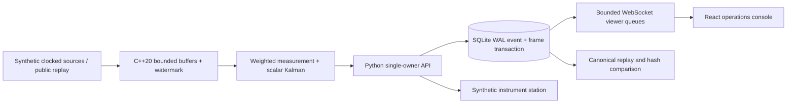
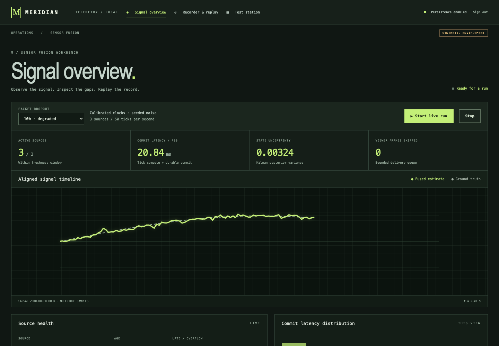

# Meridian

## Problem

Align noisy sensor streams without allowing late samples or slow viewers to rewrite committed history.

**Status: partial — live deployment is outstanding.** Independent public repository: https://github.com/rjrddy/meridian.

## Results

All figures below are derived by `scripts/render_readme.py` from saved output in [docs/results](docs/results/). They describe this local machine and workload, not production guarantees.

| Measurement | Observed result | Raw evidence |
|---|---|---|
| Local unit/integration/property/chaos tests | 14 passed | [checks.log](docs/results/checks.log) |
| Browser message-arrival latency, p50 / p99 | 0.719 / 6.187 ms | [browser.json](docs/results/browser.json), [raw samples](docs/results/browser-samples.json) |
| Observed input rate during browser trial | 73.48 samples/s across 3 sources | [browser.json](docs/results/browser.json) |
| Durable batch latency, p50 / p99 | 0.181 / 0.672 ms | [benchmark.json](docs/results/benchmark.json), [samples](docs/results/durable-samples.json) |
| Public sensor replay | 900 records; bit-identical: True | [public-replay.json](docs/results/public-replay.json) |
| Redesigned console recording | 96.36 seconds | [video](docs/results/ui-redesign/demo.webm), [ffprobe](docs/results/ui-redesign/demo-probe.json) |
| Synthetic test-station yield | 93.7% of 1000 units | [benchmark.json](docs/results/benchmark.json) |

Browser latency starts before the first event of each synthetic batch and ends at its WebSocket message handler on the same machine. It includes compute, SQLite commit and local delivery, but excludes paint and physical hardware capture. The run had configured source rates 50.00, 25.00, 16.67 Hz, 10% packet dropout and 101 received frames. These short trials do not establish a sustained service SLO. Durable batch timing excludes the browser. Core timings below measure individual adapter events without pacing or storage.

| Packet dropout | Scored ticks | RMSE, synthetic position units | Event p50 ms | Event p99 ms | Replay identical |
|---|---|---|---|---|---|
| 0% | 3000 | 0.048471 | 0.000292 | 0.003333 | True |
| 10% | 3000 | 0.050360 | 0.000292 | 0.002982 | True |
| 30% | 3000 | 0.053657 | 0.000292 | 0.002125 | True |

Raw events, estimates and timings: [nominal](docs/results/dropout-0.json), [degraded](docs/results/dropout-10.json), [stress](docs/results/dropout-30.json). The declared RMSE budget is checked by the benchmark command. Public lab temperatures have no shared ground truth: **public-data accuracy is not measured**.

Caught failures: [unsafe stale-packet baseline](docs/results/failure-unsafe.log) fails, while the [guarded core](docs/results/failure-guarded.log) rejects it. The [pre-fix dependency scan](docs/results/npm-audit-before-fix.json) blocked a vulnerable build dependency; [current frontend scan](docs/results/npm-audit.json) and [Python scan](docs/results/python-audit.json) retain the rescanned reports. Linux and fresh-install build failures were also retained before fixes. A real subprocess crash during an open SQLite transaction is tested in tests/test_chaos.py.

## Architecture





[Visual design references and UI checks](docs/UI.md) · [Redesigned console recording](docs/results/ui-redesign/demo.webm). Historical benchmark evidence remains separate.

## Run it

Docker Compose is required for the container path. From a clone:

```sh
cp .env.example .env
$EDITOR .env
docker compose up --build
```

Set your own password in the editor, then open http://localhost:8000 and sign in. The image seeds a synthetic run and instrument batch. A named local volume preserves history; no remote account is needed. For native development: `make setup build`, set MERIDIAN_PASSWORD, then run `.venv/bin/uvicorn meridian.api:create_app --factory`. Reproduce proof with `make lint test bench`; browser verification requires a running server and Chromium. Download the public sensor archive separately from the [MIT source](https://db.csail.mit.edu/labdata/data.txt.gz) and run `.venv/bin/python scripts/public_replay.py /path/to/data.txt.gz`. No source archive is redistributed.

## Decisions and limits

Read [DESIGN.md](docs/DESIGN.md), [ADRs](docs/adr), [migration record](docs/migration/meridian.md), [INTERVIEW.md](INTERVIEW.md) and [DRILL.md](docs/DRILL.md).

- Explicit reference probes calibrate offsets; clock drift is not inferred. Causal hold avoids future leakage and ages stale sources out. Unequal source rates and timestamp jitter are synthetic.
- Single scalar common coordinate, not a general multi-modal EKF. Each sample updates the filter at most once. Unmodeled cross-sensor correlation and physical dynamics mean posterior covariance is not a calibrated confidence interval. Ground-truth RMSE is measured separately.
- One application process and one writer. No distributed consensus, horizontal write scaling or hardware real-time guarantee. Run replay is bit-identical on the tested numerical build; cross-platform bit identity is not claimed.
- Authentication uses an environment password, salted scrypt, expiring server sessions, HttpOnly cookies, CSRF proofs and bounded login/write/viewer limits. Use TLS and COOKIE_SECURE for hosting. Roles, OAuth and external identity integration are absent.
- Live viewer delivery may drop frames; recorded history is authoritative. The app bounds queues but transport buffers also exist. Disk retention and backup automation are not implemented.
- Public Intel Lab data is a replay compatibility exercise across different physical locations, not a truth-scored sensor-fusion benchmark. An explicit source reuse license was not identified, so fetch the archive separately. Source and archive checksum are saved.
- Live demo: **not deployed**. The supplied free-tier Render configuration has ephemeral storage and must not be described as durable across redeploys. No hosting account was created.
- Screenshots are saved, and [exact recording steps](docs/DEMO.md) are provided. The redesigned console recording is measured in [its media probe](docs/results/ui-redesign/demo-probe.json).

## Next

Deploy with an explicitly chosen persistence policy; add independently calibrated cross-sensor correlation, clock-drift probes, longer browser load/chaos campaigns and hardware timestamping. Optional dispatch simulation and video/pose validation stay outside the required scalar fusion core; the old repositories remain intact.
